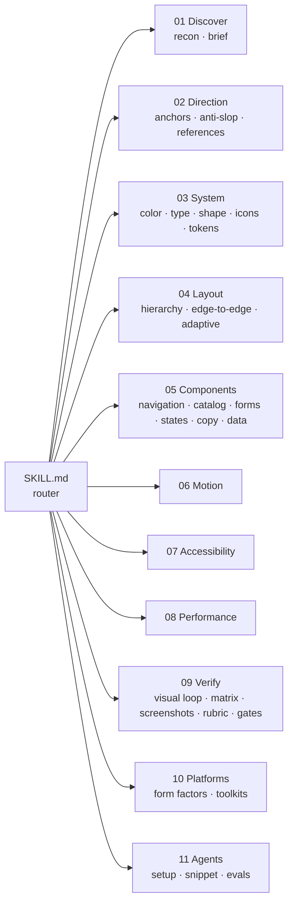

<p align="center">
  
</p>

<p align="center">
  
  
  
  
</p>

<p align="center">
  <b>English</b> · <a href="README.pt-BR.md">Português (Brasil)</a>
</p>

---

**Android Premium Craft** is an [Agent Skill](https://agentskills.io) that teaches coding agents to design, build, critique and verify Android interfaces to a premium, release-ready standard - for Jetpack Compose and XML Views, phones to foldables, Wear and TV.

It gives the agent three things it does not have on its own:

1. **Decisions** - ten named visual directions, a design-token system and an anti-slop catalogue, so the output stops looking like every other generated app.
2. **Craft knowledge** - 31 focused modules on Material 3 / Expressive, layout, edge-to-edge, adaptive, components, forms, states, copy, motion, accessibility and performance, up to date with Android 16/17 platform rules.
3. **Ways to check its own work** - a master critique with a 0-100 Craft Score, a 40-rule lint, a theme-contrast checker, a device-matrix capture that restores your phone, and an honest release gate. No invented FPS, no fake scores.

## Contents

- [What's new in v2.2](#whats-new-in-v22)
- [Before and after](#before-and-after)
- [Quick start](#quick-start)
- [Install](#install)
- [Modes](#modes)
- [The craft loop](#the-craft-loop)
- [Master critique: score your app](#master-critique-score-your-app)
- [Visual direction: 10 anchors](#visual-direction-10-anchors)
- [Tools](#tools)
- [Example session](#example-session)
- [What is inside](#what-is-inside)
- [Works with Google's official Android skills](#works-with-googles-official-android-skills)
- [Evidence, not vibes](#evidence-not-vibes)
- [FAQ](#faq)
- [Contributing](#contributing)

## What's new in v2.2

v2.2 adapts ideas from five open-source (MIT) design skills to Android. Each idea was checked for fit with native apps; web-only advice was left out.

| Area | What changed | Where | Idea from |
|---|---|---|---|
| Lint | New rule **D011**: hype copy that reads as generated (*unlock, seamless, supercharge, elevate, effortless, all-in-one, "Oops!"*) in Kotlin, layouts and `strings.xml`. The lint now has **40 rules** | `scripts/ui_audit.py` | [taste-skill](https://github.com/Leonxlnx/taste-skill) |
| Anti-slop | **Dated 2025-2026 tells** in Android form: the "warm editorial" shortcut (cream + terracotta + serif), eyebrow labels, "New/Beta/AI" pills, the accented word, mono as costume, 01/02/03 numbering, decorative status dots, fake dashboards, invented proof | `modules/02-direction/anti-slop.md` | taste-skill, [Hallmark](https://github.com/Nutlope/hallmark) |
| Anti-slop | **Removal is not enough**: a screen with every tell removed and nothing in their place is the "avoidance aesthetic". Decide the key fact, the anchor and real content first | `anti-slop.md` | taste-skill |
| Brand | **Brand truth**: never theme a real brand from colors remembered by the model; use project files, a brand guide or values from the user, and record the source in `DESIGN.md` | `modules/01-discover/product-brief.md` | Hallmark |
| Critique | Four new passes on the screenshots: **cover the logo**, **edges**, **sameness across screens**, **collisions** (FAB, snackbar, IME, system bars over content) | `modules/09-verify/master-critique.md` | taste-skill |
| Critique | **Fix order** for the action plan: specificity -> hierarchy -> layout -> type -> imagery -> color -> states -> motion | `master-critique.md` | taste-skill |
| Critique | **Fresh eyes**: when the skill built the screen, the critique runs in a sub-agent that sees only screenshots, `DESIGN.md` and the rubric | `master-critique.md` | Hallmark |
| Sources | The five repositories are credited with what was taken from each | `research/sources.md` | - |

Also reviewed, nothing adopted: [ai-design-skills](https://github.com/elayadesign/ai-design-skills) (web landing pages only). [UI/UX Pro Max](https://github.com/nextlevelbuilder/ui-ux-pro-max-skill) data went to the companion kit [Impeccable Mobile Studio](https://github.com/playertwo1/Impeccable-Mobile-Studio); [diagram-design](https://github.com/cathrynlavery/diagram-design) is credited for its practice of ADRs and a size cap on `SKILL.md`. Full list in [CHANGELOG.md](CHANGELOG.md).

## Before and after

<p align="center"></p>

The left screen is what agents tend to produce: the Material sample purple, a greeting that eats the first viewport, three equal emoji tiles, cards inside cards, 10sp gray text and a blocking spinner. The right one applies the skill: one hero fact with sign and freshness, one primary action, a list with right-aligned tabular amounts, theme roles verified for contrast and a labeled navigation bar. Every problem on the left maps to a lint rule.

## Quick start

```text
# 1. Review without touching code
/android-premium-craft critique the home screen

# 2. Agree on a direction before pixels
/android-premium-craft shape a cash-flow dashboard for small business owners

# 3. Build only what was approved
/android-premium-craft redesign the home screen following DESIGN.md

# 4. Look at the result and stress it
/android-premium-craft see
/android-premium-craft matrix

# 5. Close with evidence
/android-premium-craft release-review
```

In Codex use `$android-premium-craft ...`; in Antigravity and Hermes skills appear as slash commands or can be requested by name ("use android-premium-craft to critique this screen").

## Install

<details open>
<summary><b>Claude Code</b></summary>

As a plugin:
```text
/plugin marketplace add playertwo1/android-premium-craft
/plugin install android-premium-craft@android-premium-craft
```
Or as a personal skill:
```bash
git clone https://github.com/playertwo1/android-premium-craft
cp -r android-premium-craft/skills/android-premium-craft ~/.claude/skills/
```
</details>

<details>
<summary><b>Codex (CLI / IDE)</b></summary>

```text
codex plugin marketplace add playertwo1/android-premium-craft
codex plugin add android-premium-craft@android-premium-craft
```
Or copy `skills/android-premium-craft` to `~/.agents/skills/` (personal) or `<repo>/.agents/skills/` (project).
</details>

<details>
<summary><b>Antigravity (IDE and CLI) / Gemini CLI</b></summary>

Copy `skills/android-premium-craft` to:
- Antigravity IDE: `~/.gemini/antigravity/skills/`
- Antigravity CLI: `~/.gemini/antigravity-cli/skills/`
- Project scope (both): `<repo>/.agents/skills/`
</details>

<details>
<summary><b>Hermes desktop / Hermes Agent</b></summary>

Copy `skills/android-premium-craft` to the Hermes skills folder (`%LOCALAPPDATA%\hermes\skills\` on Windows, `~/.hermes/skills/` elsewhere) and restart Hermes.
</details>

<details>
<summary><b>One project, several agents at once</b></summary>

```bash
python skills/android-premium-craft/scripts/install_skill.py --project /path/to/app --agents claude codex antigravity
```
Never overwrites an existing install unless you pass `--replace`.
</details>

**Recommended:** paste [`AGENTS_SNIPPET.md`](skills/android-premium-craft/assets/AGENTS_SNIPPET.md) (25 lines) into your app's `AGENTS.md` / `CLAUDE.md`. Agents skip installed skills more often than you would expect; the snippet keeps the core rules always on.

## Modes

| Group | Mode | What you get | Edits code? |
|---|---|---|---|
| Review | `critique` *(default)* | Craft Score 0-100, scorecard, top issues, persona red flags, quick wins, action plan (`critique quick` for a short version) | No |
| | `audit` | Probe + lint + palette + rubric, ranked report | No |
| | `accessibility` | TalkBack, 200% text, targets, contrast, keyboard - automated and manual separated | No unless asked |
| Plan | `shape` | Brief, anchor and token proposal before any code | No |
| | `system` | `DESIGN.md` + theme code | On request |
| Build | `build` / `redesign` | New or reworked screen from an approved direction | Yes |
| | `polish` | Alignment, rhythm, type, icons, states, micro-motion | Yes |
| Steer | `bolder` / `quieter` / `distill` | Raise or lower intensity; remove nesting, chrome and decoration | Yes |
| Platform | `touch` / `space` / `adapt` | Reach and targets; insets and density; tablets, foldables, desktop | On request |
| Detail | `animate` / `copy` / `harden` | Purposeful motion; labels and errors; every state and edge case | On request |
| Verify | `see` / `matrix` | Render or capture, then self-critique; stress configurations | No |
| | `visual-regression` / `performance` | Version-correct screenshot tests; measured before/after | No auto-approve |
| | `reference` / `motion-study` | Principles from screenshots and recordings | No |
| | `release-review` | PASS / FAIL / NOT RUN per check with blockers | No |

## The craft loop

<p align="center"></p>

Every mode runs a slice of this loop. The important part is **See**: the agent renders Compose previews, captures the device with adb, or uses the Maestro MCP, then reviews the pixels against a 10-dimension rubric. Code review alone is never called visual review. Repair loops stop after two passes and report what remains.

## Master critique: score your app

Point the skill at an app you already have and it reviews it like a design director: captures the main screens (device, Maestro or previews), writes the design review **before** looking at the lint so the tool does not anchor the judgment, reconciles both, and returns a **Craft Score from 0 to 100** with a scorecard, the 3-5 issues that matter most, persona red flags, quick wins and an action plan made of this skill's modes.

```text
/android-premium-craft critique my app
/android-premium-craft critique quick the checkout screen   # no score, 5 findings
```

<p align="center"></p>

How the number is made (`scripts/critique_score.py`, so the same judgments always give the same score):

| | |
|---|---|
| **Ten dimensions, 0-4 each** | Hierarchy 14 · Accessibility 12 · Layout, Typography, Consistency, States, Touch 10 each · Color, Platform, Motion 8 each |
| **Evidence required** | Every score points to a screenshot, `file:line` or measurement; `n/a` needs a reason and renormalizes |
| **Primary journeys count double** | Each screen is scored; the app score is the weighted average |
| **Caps** | Any open P0 caps the app at 49, two or more P1 at 74, one P1 at 84 - a pretty screen that blocks a task is not "polished" |
| **Confidence** | High / medium / low from how much of the weight was judged from pixels instead of code |
| **Bands** | 90+ S Premium · 80 A Polished · 70 B Solid · 55 C Generic · 40 D Rough · below 40 E Broken |
| **Trend** | `--save .craft/critique` archives each run and prints `48D -> 63C -> 81A` |

Personas used in the walkthrough: **Casey** (one hand, on the bus), **Sam** (TalkBack + 200% text), **Rita** (65, first app), **Alex** (tablet power user) and **Riley** (stress tester).

## Visual direction: 10 anchors

<p align="center"></p>

"Make it clean and modern" produces the average of the training data. Instead the agent picks **one anchor** from the product's domain register (finance, health, media, B2B, kids...) and lets it decide color, type, shape, density, elevation and motion. Each anchor documents its signature move and the trap that ruins it. Details: [`aesthetic-anchors.md`](skills/android-premium-craft/modules/02-direction/aesthetic-anchors.md) and [`anti-slop.md`](skills/android-premium-craft/modules/02-direction/anti-slop.md).

## Tools

All scripts are Python 3.9+ with the standard library, except that `mobile.py` capture, inspect and compare use Pillow. They never modify your app (the device matrix changes device settings temporarily and restores them).

### Craft lint - 40 rules

<p align="center"></p>

```bash
python scripts/ui_audit.py lint /path/to/app                    # Markdown report
python scripts/ui_audit.py lint /path/to/app --format sarif > craft.sarif   # GitHub code scanning
python scripts/ui_audit.py lint /path/to/app --fail-on high      # CI gate
```

Suppress a finding with `// craft-lint: ignore C001` on the line or the line above.

<details>
<summary><b>All rules</b></summary>

| Id | Severity | Rule |
|---|---|---|
| X001 | high | `textSize` in dp ignores the user font scale |
| X003 | high | `ImageButton` without `contentDescription` |
| A001 | high | `IconButton` without an accessible name |
| L001 | high | `Scaffold` content ignores `innerPadding` |
| L003 | high | Edge-to-edge opt-out (disabled at targetSdk 36) |
| N001 | high | `onBackPressed()` override (not called at targetSdk 36) |
| C001 | medium | Hard-coded color in UI code |
| C003 | medium | Hex color in layout XML |
| C004 | medium | Secondary text made with alpha |
| D010 | medium | Baseline Material sample purple (`#6750A4`) |
| D011 | low | Hype copy that reads as generated |
| T001 | medium | Text smaller than 12sp |
| A003 | medium | Clickable element sized under 48dp |
| A006 | medium | Fixed height on a text-bearing component |
| X005 | medium | Button / ImageButton under 48dp |
| L002 | medium | System bar color set (ignored on Android 15+) |
| L004 | medium | Locked orientation (ignored on large screens at SDK 36+) |
| L005 | medium | `resizeableActivity="false"` (ignored on large screens at SDK 36+) |
| L007 | medium | Deprecated Accompanist system UI / insets |
| N002 | medium | `KEYCODE_BACK` interception (not dispatched at targetSdk 36) |
| N004 | medium | Predictive back opted out |
| P001 | medium | Lazy items without a stable key |
| P002 | medium | `collectAsState()` on Android |
| P005 | medium | Long tween (>= 500 ms) |
| M001 | medium | Material 2 Compose import |
| C002 | low | Named `Color` constant used for UI |
| D002 | low | Card nested inside a card |
| D003 | low | Drop shadow on content |
| D004 | low | Emoji used in UI text |
| D005 | low | Gradient brush |
| D006 | low | Spacing off the 4dp grid |
| T003 | low | Hard-coded `fontSize` in a screen |
| T004 | low | All-caps text |
| A002 | low | Bare `clickable` without role or label |
| A005 | low | Literal string in `Text()` |
| X004 | low | Literal `android:text` in layout |
| L006 | low | Fixed wide width |
| L008 | low | `adjustPan` soft input mode |
| P003 | low | Infinite animation |
| P004 | low | Blur effect |

Every finding links to the module that explains the fix. Findings are leads to verify; a clean run is not a quality pass.
</details>

### Theme contrast

```bash
python scripts/ui_audit.py palette /path/to/app
python scripts/ui_audit.py contrast '#B3FFFFFF' '#121316'    # alpha is composited over the background
```

`palette` parses `lightColorScheme(...)`, `darkColorScheme(...)` and your own `*Colors(...)` classes, resolves named colors and checks every `onX` / `x` pair plus secondary text, outlines and inverse roles against WCAG AA:

```text
## DarkColors (`ui/theme/Theme.kt:47`) - 0 failing pair(s)
| Foreground       | Background              | Ratio   | Min | Result |
| onPrimary        | primary                 | 7.73:1  | 4.5 | pass   |
| onSurfaceVariant | surfaceContainerHighest | 7.27:1  | 4.5 | pass   |
| outline          | surface                 | 5.84:1  | 3.0 | pass   |
```

### Device matrix

<p align="center"></p>

```bash
python scripts/device_matrix.py --list
python scripts/device_matrix.py --out shots/run1 --profiles core --package com.example.app --dry-run
python scripts/device_matrix.py --out shots/run1 --profiles core --package com.example.app --dump
```

14 profiles (dark, light, font 130/200%, display size, bold text, high-contrast text, animations off, 3-button and gesture navigation, RTL, pseudo-locale, landscape). Originals are saved **before** anything changes and restored after each profile; `--restore-only` recovers after a hard kill. Output: one PNG per profile, optional view tree with bounds (to measure touch targets in dp) and a `manifest.json`.

### Device tools

```bash
pip install -r requirements.txt   # Pillow, only for capture, inspect and compare
python scripts/mobile.py capture --name before --serial emulator-5554
python scripts/mobile.py compare --before a.png --after b.png --output diff/
python scripts/mobile.py test --flow assets/maestro/capture-home.yaml --app-id com.example.app --serial emulator-5554
python scripts/mobile.py guidelines --stack flutter --severity high --category Accessibility
```

Evidence goes to `.craft/` and is not overwritten unless you ask. With several devices connected, pass `--serial`: without it Maestro picks one on its own. A pixel diff finds regressions; it never says a design is better.

### Project probe and release gate

```bash
python scripts/project_probe.py /path/to/app     # toolkit, SDKs, BOM, Material 3, libraries, manifest flags, platform mandates
python scripts/review_gate.py evidence.json --require-ready
```

The probe turns `targetSdk` into concrete obligations (edge-to-edge at 35, predictive back and no `onBackPressed` at 36, mandatory large-screen support at 37). The gate reads the evidence JSON and returns `blocked`, `incomplete`, `ready_for_visual_review` or `verified_for_scope`.

## Example session

<details open>
<summary><code>/android-premium-craft critique</code> on the bundled sloppy app</summary>

```markdown
Method: design review + deterministic scan (code only, no device)

## Critique - Home

Direction check: no anchor; reads as the Material sample template.
Craft Score: 30/100 - E (Broken) · confidence: low (code only, 0% from pixels)

Strengths
1. Compose + Material 3 already in place; theme can be fixed centrally.
2. Data is in a lazy list, so density changes are cheap.

Findings
| # | Sev | Finding                                          | Evidence             | Fix                                         |
|---|-----|--------------------------------------------------|----------------------|---------------------------------------------|
| 1 | P1  | Search IconButton has no TalkBack name            | HomeScreen.kt:30 A001 | contentDescription = "Search"               |
| 2 | P1  | Scaffold innerPadding ignored - content under bars | HomeScreen.kt:21 L001 | pass innerPadding as contentPadding         |
| 3 | P1  | onBackPressed override is never called at SDK 36  | HomeScreen.kt:11 N001 | OnBackPressedCallback / navigation back     |
| 4 | P1  | Portrait lock + non-resizable on tablets          | AndroidManifest.xml:6 | support rotation; adaptive layout           |
| 5 | P2  | Greeting + gradient hero hide the balance         | HomeScreen.kt:20-22   | one hero fact + primary action (Tonal Calm) |

Not verified: visual (no screenshots), TalkBack, performance.
Next action: `shape` to pick the anchor, then `redesign` the header region.
```
</details>

## What is inside



```
skills/android-premium-craft/
├── SKILL.md              167-line router: principles, craft loop, modes, module index
├── modules/              32 modules in 11 groups, loaded only when a mode needs them
├── research/             evidence ledger (what is proven vs opinion) and dated sources
├── assets/
│   ├── compose/          CraftTheme.kt · CraftPreviews.kt · A11yCheckTest.kt
│   ├── DESIGN_TEMPLATE.md · CRITIQUE_TEMPLATE.json · REVIEW_EVIDENCE_TEMPLATE.json
│   └── AGENTS_SNIPPET.md
├── data/                 Compose, Flutter, React Native and cross-stack guideline tables
├── scripts/              ui_audit · critique_score · project_probe · device_matrix · mobile · review_gate · install · validate
├── evals/                9 scenarios + a sloppy fixture and a buildable demo app with planted faults
└── tests/                82 unit tests
```

The Compose templates are ready to copy: [`CraftTheme.kt`](skills/android-premium-craft/assets/compose/CraftTheme.kt) (light/dark schemes, extended success/warning roles, spacing tokens, tabular numerals - passes its own contrast check), [`CraftPreviews.kt`](skills/android-premium-craft/assets/compose/CraftPreviews.kt) (light/dark, 200% text, RTL, landscape, one preview per UI state) and [`A11yCheckTest.kt`](skills/android-premium-craft/assets/compose/A11yCheckTest.kt).

## Works with Google's official Android skills

Google's [android/skills](https://github.com/android/skills) cover specific migrations in depth and deliberately skip the basics. This skill covers direction, craft, critique and verification, and **hands off** instead of duplicating:

| Task | Official skill |
|---|---|
| Edge-to-edge migration, IME, bar legibility | `edge-to-edge` |
| Multi-pane, rail, MediaQuery, Grid/FlexBox | `adaptive` |
| Recomposition, stability, jank | `jetpack-compose-performance` |
| Navigation 3 / predictive back on SDK 36+ | `navigation-3`, `navigation-event` |
| Compose Styles API, XML to Compose | `styles`, `migrate-xml-views-to-jetpack-compose` |
| Test setup, Wear, TV, XR glasses, widgets | `testing-setup`, `wear-compose-m3`, `leanback-to-compose-tv-migration`, `display-glasses-with-jetpack-compose-glimmer`, `glance-canonical-layouts` |

## Evidence, not vibes

Every claim in a report carries one of: `observed`, `verified-in-code`, `measured`, `automated-pass`, `not-run`. The Craft Score is computed by a script with published weights and caps, carries a confidence level and is never presented as a measurement. Performance claims require a same-device, release-build measurement. The release gate only lints the report; it never pretends to have run your app. Research is kept in an [evidence ledger](skills/android-premium-craft/research/evidence.md) that separates platform rules, studies (e.g. the CHI '26 M3 Expressive study) and community anecdotes.

## FAQ

**Does it only do dark themes?** No. Dark is one anchor (Tonal Calm) out of ten; the default is light + dark + dynamic color unless your brand says otherwise.

**Compose only?** Compose first, XML Views fully covered, plus a concept map, device tools and guideline tables for Flutter and React Native. The lint reads Kotlin, Java and XML.

**Will it upgrade my AGP, Compose or Material version?** No. It checks version gates and uses fallbacks; upgrades happen only when you ask.

**Does it need a device?** No, but it is better with one. Without a device or previews, visual checks are reported as `not-run`.

**Does anything leave my machine?** No. Scripts are local and read-only; nothing is uploaded.

## Contributing

The best contribution is a real failure: the prompt, the model, what the agent did and what it should have done. Changes to the skill should come with an eval scenario or a lint test that fails before and passes after.

```bash
cd skills/android-premium-craft
python scripts/validate_skill.py           # Agent Skills spec + internal links
python -m unittest discover -s tests -v    # 81 tests
```

See [CHANGELOG.md](CHANGELOG.md) and the v1.2 to v2.0 write-up in [IMPROVEMENTS.md](IMPROVEMENTS.md) (Portuguese).

## License

[Apache-2.0](LICENSE). Material Design, Android and Jetpack Compose are trademarks of Google LLC; this project is not affiliated with Google.
