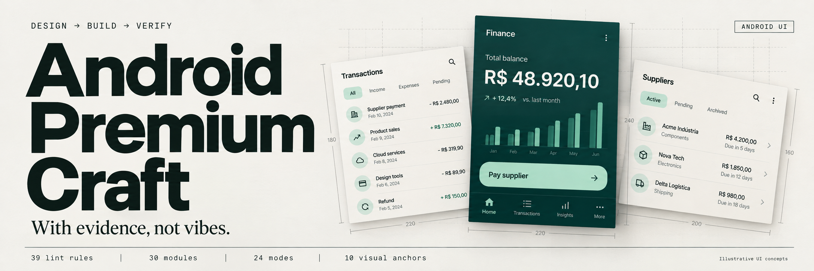
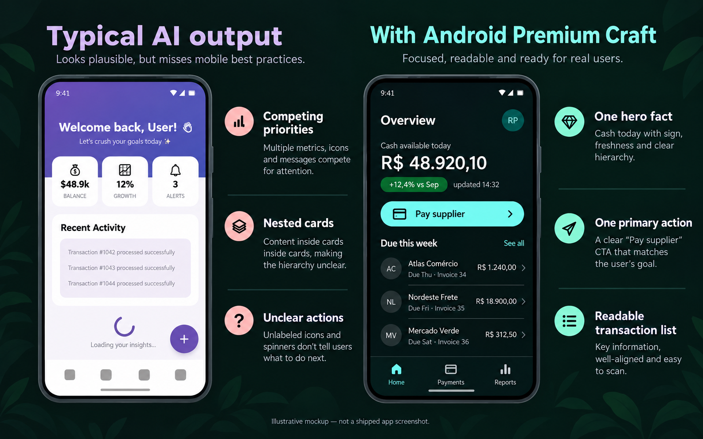
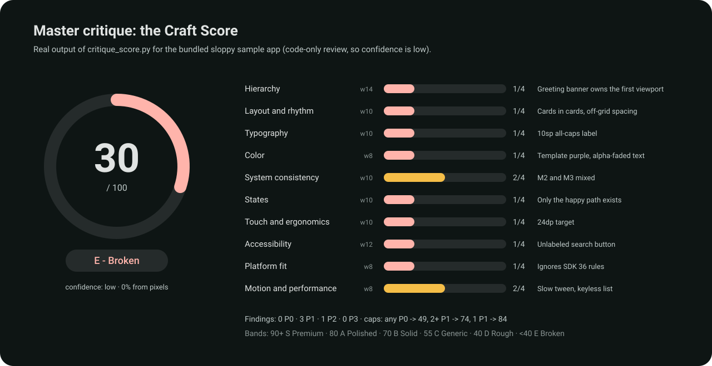
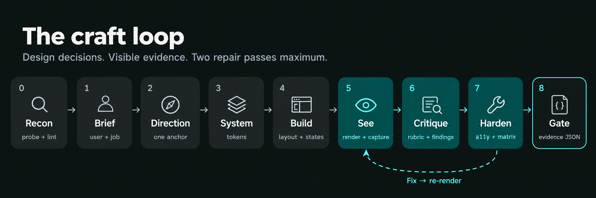
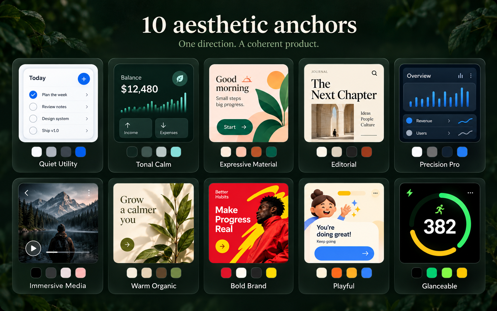
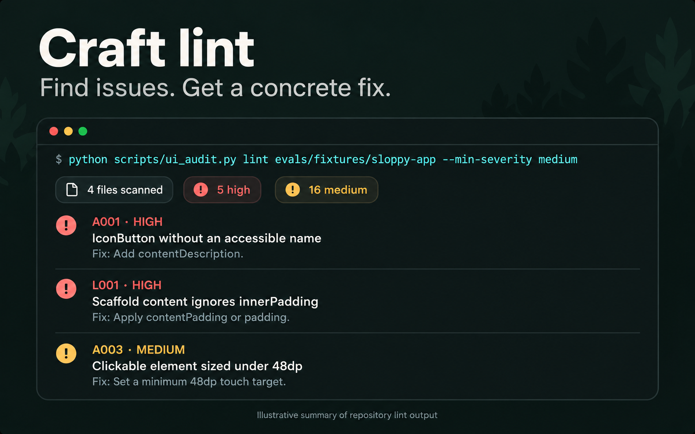
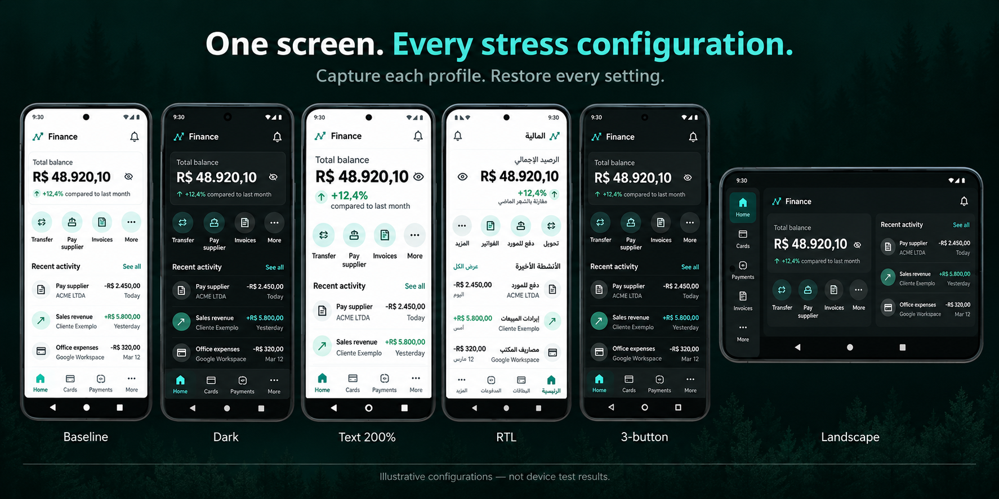

<p align="center">
  
</p>

<p align="center">
  
  
  
</p>

<p align="center">
  <a href="README.md">English</a> · <b>Português (Brasil)</b>
</p>

---

**Android Premium Craft** é uma [Agent Skill](https://agentskills.io) que ensina agentes de IA a projetar, construir, criticar e verificar interfaces Android em padrão premium e pronto para release - Jetpack Compose e XML Views, do celular ao dobrável, Wear e TV. Funciona no **Claude Code, Codex, Antigravity, Gemini CLI e Hermes**.

Ela dá ao agente três coisas que ele não tem sozinho:

1. **Decisões** - dez direções visuais com nome, um sistema de tokens de design e um catálogo "anti-slop", para o resultado parar de parecer com todo app gerado por IA.
2. **Conhecimento de ofício** - 31 módulos sobre Material 3 / Expressive, layout, edge-to-edge, telas grandes, componentes, formulários, estados, textos, motion, acessibilidade e performance, atualizados com as regras do Android 16/17.
3. **Como conferir o próprio trabalho** - critique mestre com nota de 0 a 100, lint com 40 regras, checagem de contraste do tema, captura em matriz de dispositivos que restaura o aparelho e um gate de release honesto. Sem FPS inventado, sem nota de mentira.

## Novidades da v2.2

A v2.2 adapta ao Android ideias de cinco skills de design abertas (MIT). Cada ideia foi conferida para app nativo; conselho só de web ficou de fora.

| Área | O que mudou | Onde | Ideia de |
|---|---|---|---|
| Lint | Regra nova **D011**: copy de marketing que soa gerada (*unlock, seamless, supercharge, elevate, effortless, all-in-one, "Oops!"*) em Kotlin, layouts e `strings.xml`. Agora são **40 regras** | `scripts/ui_audit.py` | [taste-skill](https://github.com/Leonxlnx/taste-skill) |
| Anti-slop | **Sinais datados de 2025-2026** na forma Android: atalho "editorial premium" (creme + terracota + serifa), rótulo sobrancelha, pílulas "Novo/Beta/IA", palavra destacada no título, monoespaçada como fantasia, numeração 01/02/03, ponto de status decorativo, dashboard falso, prova inventada | `modules/02-direction/anti-slop.md` | taste-skill, [Hallmark](https://github.com/Nutlope/hallmark) |
| Anti-slop | **Remover não basta**: tela sem nenhum sinal e sem nada no lugar é a "estética da evitação". Primeiro o fato principal, a âncora e o conteúdo real | `anti-slop.md` | taste-skill |
| Marca | **Marca real**: nunca tematizar uma marca com cores lembradas pelo modelo; usar arquivos do projeto, guia de marca ou valores do usuário e registrar a origem no `DESIGN.md` | `modules/01-discover/product-brief.md` | Hallmark |
| Crítica | Quatro passes novos sobre as capturas: **cobrir o logo**, **bordas**, **mesmice entre telas**, **colisões** (FAB, snackbar, teclado, barras do sistema sobre o conteúdo) | `modules/09-verify/master-critique.md` | taste-skill |
| Crítica | **Ordem de correção** no plano: identidade -> hierarquia -> layout -> tipografia -> imagens -> cor -> estados -> motion | `master-critique.md` | taste-skill |
| Crítica | **Olhos novos**: quando a skill construiu a tela, a crítica roda em um subagente que só vê as capturas, o `DESIGN.md` e a rubrica | `master-critique.md` | Hallmark |
| Fontes | Os cinco repositórios creditados com o que veio de cada um | `research/sources.md` | - |

Também analisados, sem adoção: [ai-design-skills](https://github.com/elayadesign/ai-design-skills) (só landing page web). Os dados do [UI/UX Pro Max](https://github.com/nextlevelbuilder/ui-ux-pro-max-skill) foram para o kit irmão [Impeccable Mobile Studio](https://github.com/playertwo1/Impeccable-Mobile-Studio); o [diagram-design](https://github.com/cathrynlavery/diagram-design) é creditado pela prática de ADRs e limite de tamanho do `SKILL.md`. Lista completa no [CHANGELOG.md](CHANGELOG.md).

## Antes e depois

<p align="center"></p>

À esquerda, o que agentes costumam gerar: o roxo de exemplo do Material, um "Bem-vindo de volta" ocupando a primeira dobra, três blocos iguais com emoji, card dentro de card, texto cinza de 10sp e um spinner bloqueando tudo. À direita, com a skill: um fato principal com sinal e horário de atualização, uma ação primária, lista com valores alinhados e numerais tabulares, papéis de cor verificados e barra de navegação com rótulos. Cada problema da esquerda corresponde a uma regra do lint.

## Começo rápido

```text
/android-premium-craft critique meu app                 # nota 0-100 + o que melhorar
/android-premium-craft shape um painel de fluxo de caixa # direção antes do código
/android-premium-craft redesign a tela inicial seguindo o DESIGN.md
/android-premium-craft see                              # renderizar/capturar e autocriticar
/android-premium-craft matrix                           # escuro, 200%, RTL, paisagem...
/android-premium-craft release-review                   # PASS / FAIL / NOT RUN por checagem
```

No Codex use `$android-premium-craft ...`; no Antigravity e no Hermes a skill vira comando de barra ou pode ser pedida pelo nome.

## Instalação

| Agente | Onde copiar `skills/android-premium-craft` |
|---|---|
| Claude Code | `~/.claude/skills/` - ou plugin: `/plugin marketplace add playertwo1/android-premium-craft` e `/plugin install android-premium-craft@android-premium-craft` |
| Codex | `~/.agents/skills/` (pessoal) ou `<repo>/.agents/skills/` - ou `codex plugin marketplace add playertwo1/android-premium-craft` |
| Antigravity IDE | `~/.gemini/antigravity/skills/` |
| Antigravity CLI | `~/.gemini/antigravity-cli/skills/` |
| Hermes desktop | `%LOCALAPPDATA%\hermes\skills\` (Windows) ou `~/.hermes/skills/` |
| Vários agentes num projeto | `py skills\android-premium-craft\scripts\install_skill.py --project "C:\SEU-APP" --agents claude codex antigravity` |

**Recomendado:** cole [`AGENTS_SNIPPET.md`](skills/android-premium-craft/assets/AGENTS_SNIPPET.md) no `AGENTS.md` / `CLAUDE.md` do app. Agentes ignoram skills instaladas com mais frequência do que se imagina; o snippet mantém as regras principais sempre ativas.

## Critique mestre: nota para o seu app

Aponte a skill para um app que você já tem e ela revisa como um diretor de design: captura as telas principais (aparelho, Maestro ou previews), escreve a revisão de design **antes** de olhar o lint (para a ferramenta não enviesar o julgamento), cruza os dois e devolve uma **Craft Score de 0 a 100** com scorecard, os 3-5 problemas que mais importam, alertas por persona, ganhos rápidos e um plano de ação com os modos da skill.

```text
/android-premium-craft critique meu app
/android-premium-craft critique quick a tela de checkout   # sem nota, 5 achados
```

<p align="center"></p>

Como a nota é calculada (`scripts/critique_score.py`, então o mesmo julgamento sempre dá a mesma nota):

- **10 dimensões de 0 a 4**, com pesos: hierarquia 14, acessibilidade 12, layout/tipografia/consistência/estados/toque 10, cor/plataforma/motion 8.
- **Evidência obrigatória** em cada nota (screenshot, `arquivo:linha` ou medição); `n/a` exige motivo e renormaliza.
- **Telas das jornadas principais valem o dobro.**
- **Tetos:** qualquer P0 aberto limita a nota a 49; dois ou mais P1 a 74; um P1 a 84.
- **Confiança** alta/média/baixa conforme quanto foi julgado olhando pixels, não código.
- **Faixas:** 90+ S Premium · 80 A Polished · 70 B Solid · 55 C Generic · 40 D Rough · abaixo de 40 E Broken.
- **Evolução:** `--save .craft/critique` guarda cada rodada e mostra `48D -> 63C -> 81A`.
- **Personas:** Casey (uma mão, no ônibus), Sam (TalkBack + 200%), Rita (65 anos, primeiro app), Alex (tablet, usuário avançado), Riley (testa limites).

## O ciclo de ofício

<p align="center"></p>

Todo modo executa uma parte desse ciclo. O passo central é **Ver**: o agente renderiza previews do Compose, captura o aparelho via adb ou usa o Maestro MCP, e revisa os pixels com uma rubrica de 10 dimensões. Revisão de código nunca é chamada de revisão visual. Os ciclos de correção param depois de duas passadas e reportam o que sobrou.

## Direção visual: 10 âncoras

<p align="center"></p>

"Deixa limpo e moderno" produz a média dos dados de treino. Em vez disso, o agente escolhe **uma âncora** a partir do domínio do produto (finanças, saúde, mídia, B2B, infantil...) e ela decide cor, tipografia, forma, densidade, elevação e motion. Cada âncora documenta sua marca registrada e a armadilha que a estraga.

## Ferramentas

Python 3.9+ só com a biblioteca padrão. Nada altera o seu app (a matriz de dispositivos muda configurações do aparelho temporariamente e restaura).

<p align="center"></p>

| Script | Faz |
|---|---|
| `critique_score.py` | Calcula a Craft Score 0-100, scorecard e evolução entre rodadas |
| `ui_audit.py lint` | 40 regras (acessibilidade, insets, back, cores, tipografia, performance, slop), saída Markdown/JSON/SARIF, `--fail-on high` para CI |
| `ui_audit.py palette` | Contraste WCAG de todos os pares de papéis do tema |
| `ui_audit.py contrast` | Contraste com cor translúcida (`#AARRGGBB`) |
| `project_probe.py` | Toolkit, SDKs, BOM, Material 3, bibliotecas, flags do manifest e obrigações por targetSdk |
| `device_matrix.py` | 14 perfis via adb, PNG + árvore de views, restauração garantida |
| `review_gate.py` | Valida o relatório de evidências e devolve `blocked` / `incomplete` / `ready_for_visual_review` / `verified_for_scope` |
| `mobile.py` | Captura, inspeção, comparação de telas, Maestro local (`--serial`) e diretrizes por stack; captura, inspeção e comparação usam Pillow |
| `validate_skill.py` | Autochecagem contra a especificação Agent Skills |

<p align="center"></p>

## O que tem dentro

```
skills/android-premium-craft/
├── SKILL.md              roteador de 167 linhas: princípios, ciclo, modos, índice
├── modules/              32 módulos em 11 grupos, carregados só quando o modo precisa
├── research/             evidências (o que é prova vs. opinião) e fontes datadas
├── assets/compose/       CraftTheme.kt · CraftPreviews.kt · A11yCheckTest.kt
├── assets/               DESIGN_TEMPLATE.md · CRITIQUE_TEMPLATE.json · REVIEW_EVIDENCE_TEMPLATE.json · AGENTS_SNIPPET.md
├── data/                 tabelas de diretrizes Compose, Flutter, React Native e multiplataforma
├── scripts/              ui_audit · critique_score · project_probe · device_matrix · mobile · review_gate · install · validate
├── evals/                9 cenários + um exemplo ruim e um app compilável com falhas plantadas
└── tests/                81 testes unitários
```

## Evidência, não impressão

Toda afirmação num relatório recebe um status: `observed`, `verified-in-code`, `measured`, `automated-pass` ou `not-run`. A Craft Score é calculada por script, com pesos e tetos publicados e nível de confiança, e nunca é apresentada como medição. Ganho de performance exige medição no mesmo aparelho com build release. O gate de release só confere o relatório; ele nunca finge ter rodado o seu app.

## Perguntas frequentes

- **Só tema escuro?** Não. Escuro é uma âncora (Tonal Calm) entre dez; o padrão é claro + escuro + cor dinâmica.
- **Só Compose?** Compose primeiro, XML Views coberto, e um mapa de conceitos para Flutter, React Native e Compose Multiplatform.
- **Vai atualizar AGP/Compose/Material?** Não. Confere as versões e usa alternativas; upgrade só se você pedir.
- **Precisa de aparelho?** Não, mas fica melhor com um. Sem aparelho ou previews, as checagens visuais saem como `not-run`.
- **Algo sai da minha máquina?** Não. Os scripts são locais e só leem.

Diagnóstico da v1.2 e tudo o que mudou na v2: [IMPROVEMENTS.md](IMPROVEMENTS.md). Licença: [Apache-2.0](LICENSE).
